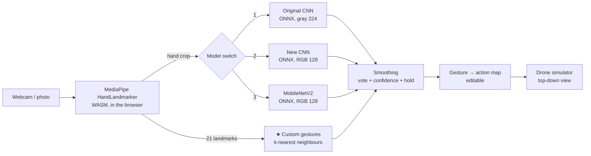
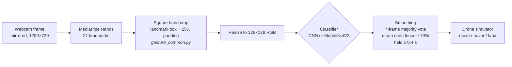
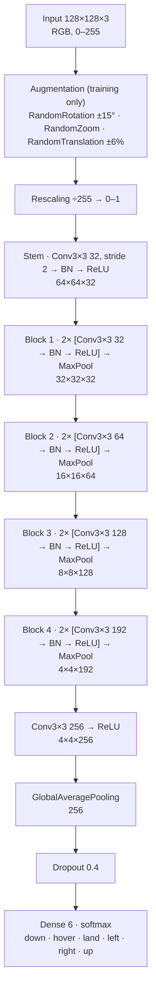
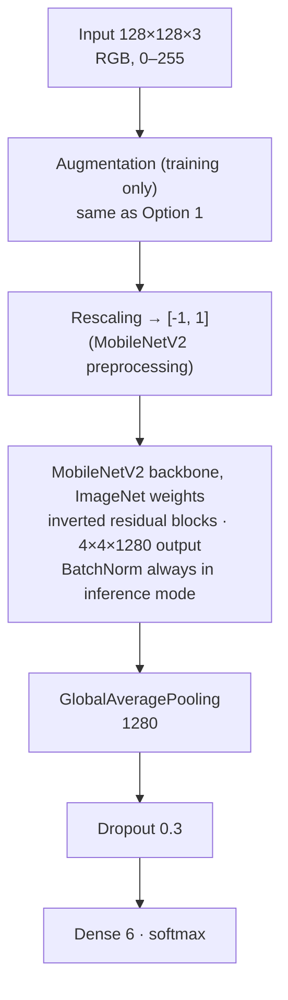

# Gesture-Controlled Drone Control System

Fly a (simulated) drone with hand gestures from your webcam. MediaPipe finds the
hand, a CNN classifies the RGB hand crop into one of six commands, and the drone
moves.

There are two ways to run it:

- **Web app** (`web/`): runs entirely in the browser and deploys to Vercel as
  a static site. You can switch between the three trained models (original
  CNN → new CNN → MobileNetV2) or teach it **your own custom gestures** and map
  each one to any drone action. You can also compare all models side by side
  and test with sample photos when there's no webcam.
- **Desktop scripts** (Python + OpenCV): collect data, train, compare models,
  and run the original OpenCV simulator.

| Gesture | Command | Hand pose |
|---|---|---|
| `up` | climb | thumbs up |
| `down` | descend | thumbs down |
| `left` | move left | index finger pointing left (as seen on screen) |
| `right` | move right | index finger pointing right (as seen on screen) |
| `hover` | hold position | open palm, fingers spread |
| `land` | land | fist |

## Web app



| Feature | Details |
|---|---|
| **Model switcher** | `1` Original CNN · `2` New CNN · `3` MobileNetV2 · `4` Custom (buttons or number keys). Models download on first use (11.5 MB / ~5 MB / ~9 MB) and run with [ONNX Runtime Web](https://onnxruntime.ai/docs/tutorials/web/). |
| **Editable gesture → action map** | Each of the six trained gestures can trigger any action: take off, land, climb, descend, strafe left/right, forward, backward, rotate left/right, hover, or nothing. |
| **Custom gestures** | Add a gesture, name it, choose an action, and press **Record** (30 samples from the webcam, or **+ Add photo** from a still image). Rename, re-record, clear or delete any time. Export/import as JSON. A starter set of 7 gestures (thumbs up/down, palm, fist, point left/right, peace sign) loads on the first visit. |
| **Compare models** | Runs every trained model on the same hand crop and shows each one's prediction, confidence and latency, next to its validation accuracy. |
| **Test without a webcam** | Six sample photos (HaGRID, people no model trained on) or **Test image** to upload your own. |
| **Settings** | Confidence threshold, hold time, smoothing window, drone speed, custom-gesture k and match distance, mirror on/off. |
| **Privacy** | Video never leaves the device. Gestures and settings are stored in the browser's `localStorage`. |

**How custom gestures work.** A hand is described by its 21 MediaPipe
landmarks relative to the wrist, scaled by hand size: 63 numbers that capture
shape and direction but not position or distance from the camera. A new hand
gets the distance-weighted vote of its 5 nearest recorded samples. If it's
farther than 0.25 from every sample, it's "unknown", so unfamiliar poses don't
move the drone. There's no training step, so adding or editing a gesture takes
effect immediately. Calibrated on HaGRID: with 30 samples per gesture recorded
from *other* people, nearest-neighbour labels **96.1%** of new hands correctly.
Your own samples will match your hand more closely.

### Run it locally

```bash
python -m http.server 5173 --directory web
```

Open <http://localhost:5173>. Browsers only allow webcam access on `localhost`
or HTTPS.

### Deploy to Vercel

The app is plain static files (`web/`) with no build step. `vercel.json` already
points Vercel at `web/` and sets cache and camera-permission headers.

1. Push this repo to GitHub.
2. Go to [vercel.com/new](https://vercel.com/new), import the repo, keep the
   defaults (Framework preset **Other**; `vercel.json` handles the rest), and
   click **Deploy**.

Or from the command line:

```bash
npm i -g vercel
vercel --prod
```

`.vercelignore` keeps the training data and Python files out of CLI uploads.
Only `web/` is served.

### Updating the web models after retraining

The web app uses ONNX copies of the Keras models. Export runs in its own
environment because `tf2onnx` needs protobuf 3.20 while MediaPipe needs 4.x:

```bash
python -m venv .venv-export
.venv-export\Scripts\pip install -r requirements-export.txt     # Windows
.venv-export\Scripts\python export_web_models.py
```

This writes `web/models/*.onnx` and `web/models/manifest.json`, and checks every
ONNX model against its Keras original. The original CNN's 11M-weight Dense layer
is stored as 8-bit integers, shrinking it from 134 MB to 11.5 MB with identical
predictions. Copy your old `gesture_model_final.h5` to `models/legacy/` first;
it's git-ignored because it exceeds GitHub's 100 MB file limit.

## How it works (desktop pipeline)



The same cropping code (`gesture_common.py`) is used when collecting data,
preparing HaGRID, training and running the simulator, so the model always sees
hands framed the same way. Crops are taken from the clean frame *before*
landmarks or boxes are drawn on it.

## Model architecture

There are two interchangeable models, picked with `--arch` in both
`train_cnn.py` and `drone_simulation.py`. Both take a raw 128×128 RGB crop
(0–255) and output six class probabilities, so the rest of the pipeline doesn't
care which one is loaded.

### Option 1: custom CNN (`--arch cnn`)

A VGG-style network trained from scratch: **1.30M parameters, about 5 MB**.



### Option 2: pretrained MobileNetV2 (`--arch mobilenetv2`, default)

MobileNetV2 with ImageNet weights as the feature extractor, plus a new
classifier head. The weights (about 9 MB) download automatically the first time.



Training runs in two phases:

1. **Head only** (8 epochs, learning rate 1e-3): backbone frozen, so the
   randomly initialised head can't send large gradients back into the
   pretrained weights.
2. **Fine-tune** (remaining epochs, learning rate 1e-4): the top 40 backbone
   layers are unfrozen and adapt to hands. The lower layers (generic edges and
   textures) and every BatchNorm layer stay frozen.

### Design decisions and why

| Decision | Why |
|---|---|
| **Crop the hand with MediaPipe first, then classify the crop** | The classifier only has to learn *hand shape*, not where a hand is in a cluttered room. That's a much easier problem, which is why a 1.3M-parameter network is enough. MediaPipe's landmarks also give a stable box from frame to frame. |
| **Square crop with 25% padding, black fill at the image edges** | Squaring avoids stretching the hand (a squashed thumbs-up looks different). Padding keeps the fingertips in frame. Black fill keeps the hand centred even near the image border, instead of shifting the box. |
| **RGB instead of grayscale** | Skin colour against the background is a strong cue for separating the hand from clutter, and the HaGRID photos are colour. Old grayscale captures still work: they load as three equal channels, and random grayscale augmentation (20%) teaches the model not to *depend* on colour. |
| **128×128 input** (was 224×224) | A hand crop has little fine detail. 128 px keeps finger positions clear while cutting computation by about 3× versus 224, which matters for real-time inference on a laptop CPU. 128 is also one of MobileNetV2's native ImageNet resolutions. |
| **Stride-2 stem convolution** | Halves the resolution straight away (128 → 64). Running the double-conv blocks at full resolution cost about 4× the compute (12 min per epoch on a laptop CPU) without adding useful detail for a hand crop. |
| **Pairs of 3×3 convolutions per block** | Two stacked 3×3 convs see the same 5×5 area as one 5×5 conv, with fewer parameters and an extra non-linearity (the VGG idea). Doubling channels as resolution halves keeps the compute per block roughly even. |
| **BatchNorm after every conv** | Stabilises training from scratch and allows a higher learning rate. It matters more here because colour augmentation makes input statistics vary a lot between batches. |
| **GlobalAveragePooling instead of Flatten → Dense** | The original model flattened a 26×26×128 map into a Dense(128) layer: about 11M parameters in one layer and a 134 MB file, which overfit 600 images easily. GAP has no parameters, ignores *where* in the crop a feature appears, and shrank the model about 9×. |
| **Dropout before the classifier** | Cheap regularisation on the one fully connected layer. Less is used for MobileNetV2 (0.3 vs 0.4) because pretrained features overfit less. |
| **Augmentation as Keras layers / in `tf.data`, not on disk** | The old Augmentor step wrote augmented copies into the class folders. These leaked into validation and inflated the score, and `land` was never augmented at all. On-the-fly augmentation gives a fresh variant every epoch, never touches validation, and the geometric layers switch off automatically at inference. |
| **Horizontal flip swaps `left` ↔ `right`** | A mirrored left-point *is* a right-point. Swapping the label doubles the useful left/right data instead of corrupting it, as a plain flip would. |
| **Class weights** | Keeps the loss balanced when classes have different numbers of images. |
| **Validation split by person (HaGRID) and by recording block (own data)** | Consecutive webcam frames are near-duplicates, so a random split would put copies of validation frames in training. Holding out whole people or bursts measures what matters: does it work on a hand it hasn't seen? |
| **Early stopping + learning-rate decay + best checkpoint** | Training stops once validation accuracy stops improving, and the best epoch is saved rather than the last one. |
| **Model rescales its own input** | Both architectures accept raw 0–255 pixels and normalise internally (÷255 for the CNN, [-1, 1] for MobileNetV2). The simulator feeds them identically, so preprocessing can't silently mismatch. |
| **Option 2: pretrained MobileNetV2** | ImageNet features (edges, skin texture, object parts) transfer well and need less hand data. Depthwise-separable convolutions keep it fast enough for real time. The trade-off is a larger model (about 2.3M parameters) and a one-time weights download. |
| **Smoothing in the simulator** | Per-frame predictions flicker. A 7-frame majority vote, a 70% mean-confidence threshold and a 0.4 s hold stop a single misclassified frame from moving the drone. |

## Data

Training combines two sources:

1. **Your own captures** in `data/<gesture>/` (100 images per gesture are
   included). The original images were recorded in grayscale with the MediaPipe
   skeleton drawn on top; `data_collection.py` now records clean colour crops,
   and new captures are added next to the old ones.
2. **[HaGRID](https://github.com/hukenovs/hagrid)** (HAnd Gesture Recognition
   Image Dataset), via the 30k-image, 384p sample on Hugging Face:
   [`cj-mills/hagrid-sample-30k-384p`](https://huggingface.co/datasets/cj-mills/hagrid-sample-30k-384p)
   (CC BY-SA 4.0). That's real RGB photos of thousands of different people,
   backgrounds and lighting conditions. `prepare_hagrid.py` crops the hands
   and maps the classes:

   | HaGRID class | Drone gesture |
   |---|---|
   | `like` | `up` |
   | `dislike` | `down` |
   | `palm` | `hover` |
   | `fist` | `land` |
   | `one` rotated 90° counter-clockwise / clockwise | `left` / `right` |

   HaGRID has no sideways-pointing class, so `left`/`right` are made by rotating
   the upright index-finger (`one`) crops. This gives about 9,800 training and
   1,500 validation crops, split by person.

## Setup

Python **3.9–3.11** (TensorFlow 2.13 doesn't support 3.12+).

```bash
python -m venv .venv
# Windows
.venv\Scripts\activate
# macOS / Linux
source .venv/bin/activate

pip install -r requirements.txt
```

## Usage

### 1. Run the simulator with an included model

```bash
python drone_simulation.py                      # MobileNetV2 (default, most accurate)
python drone_simulation.py --arch cnn           # new CNN
python drone_simulation.py --camera 1           # different webcam
```

Press **T** to take off, then use gestures. **L** lands, **R** re-centres, **Q** quits.
Movement gestures move the drone continuously while held; `land` fires once.

### 2. (Optional) Get the HaGRID data and retrain

```bash
python prepare_hagrid.py                    # downloads ~1 GB once, writes datasets/hagrid_crops/
python train_cnn.py                         # MobileNetV2 (default), your captures + HaGRID
python train_cnn.py --arch cnn              # new CNN from scratch
python train_cnn.py --no-hagrid             # your captures only
```

Each run writes `models/<model>.keras`, `models/<model>.json` (class names,
input size, validation scores) and `models/<model>_curves.png`.

### 3. Compare all three models

```bash
python compare_models.py
```

Scores the original grayscale CNN, the new CNN and MobileNetV2 on the same
held-out images: your captures, plus HaGRID people none of the models trained on.
It also reports macro F1, per-class accuracy, size and CPU latency. Results go
to `models/comparison.md` and `models/comparison.json`; the web app's Compare tab
uses the JSON via the export step.

### 4. (Optional) Record more of your own data

```bash
python data_collection.py
```

Keys `0`–`5` pick the gesture (0 up, 1 down, 2 left, 3 right, 4 hover, 5 land),
**SPACE** starts/stops recording, **q** quits. Each run records up to 100 new
frames per gesture, spaced 0.1 s apart, and never overwrites existing files.

## Results

All three models scored on the same held-out images by `compare_models.py`:
120 of your captures (the last 20% of each class) and 1,474 HaGRID crops of
people none of the models trained on.

| Model | Your captures | HaGRID (unseen people) | All | Macro F1 | Params | Keras file | Web (ONNX) |
|---|---|---|---|---|---|---|---|
| ① Original CNN (grayscale 224) | 100.0%* | 24.9% | 30.6% | 0.298 | 11.17M | 134.1 MB | 11.5 MB |
| ② New CNN (RGB 128) | 84.2% | **99.7%** | 98.6% | 0.985 | 1.30M | 15.7 MB | 5.2 MB |
| ③ MobileNetV2 (RGB 128) | **98.3%** | 99.6% | **99.5%** | **0.995** | 2.27M | 23.0 MB | 8.9 MB |

\* The original CNN was trained on *all* of `data/`, including these 120
images, so that number flatters it. Its 24.9% on new people (chance is 16.7%)
is the honest measure: it learned your hand, your lighting and the skeleton
overlay, not the gestures.

Per-class accuracy over all validation images:

| Model | down | hover | land | left | right | up |
|---|---|---|---|---|---|---|
| ① Original CNN | 43% | 26% | 11% | 43% | 34% | 25% |
| ② New CNN | 100% | 100% | 92% | 100% | 99% | 100% |
| ③ MobileNetV2 | 100% | 100% | 100% | 100% | 100% | 98% |

**Takeaways**

- **More varied data made the biggest difference.** Both new models train on
  about 9,800 HaGRID crops from thousands of people, and both go from about 25%
  to above 99% on people they've never seen.
- **MobileNetV2 is the most accurate overall.** Its ImageNet pretraining makes
  it robust on *your* setup too (98.3% vs 84.2% for the new CNN), which matters
  most for flying with your own webcam. It's the recommended default.
- **The new CNN is the smallest and fastest** (5.2 MB in the browser). It's
  nearly perfect on HaGRID but weaker on your old grayscale captures, mainly
  `land`. Recording a few hundred new colour captures with `data_collection.py`
  and retraining should close that gap.
- **Custom gestures** (nearest-neighbour on landmarks, in the web app) reach
  96.1% on new people with 30 samples per gesture, and need no training at all.

Training notes:
- MobileNetV2 trained 16 epochs: 5 with the backbone frozen (77% validation
  accuracy), then 11 fine-tuning, where validation accuracy jumped to 98% in
  the first fine-tuning epoch.
- The new CNN was stopped after epoch 14 of 20, at about 33 minutes per epoch
  on a laptop CPU. The best checkpoint (epoch 12) is kept.
- Training curves are in `models/*_curves.png`.

Single-image latency on a laptop CPU (i5-1135G7):

| | ① Original | ② New CNN | ③ MobileNetV2 |
|---|---|---|---|
| Keras (Python) | 39 ms | 52 ms | 207 ms |
| Browser (ONNX Runtime Web, WASM) | 56–66 ms | 23–41 ms | 17–39 ms |

In the browser both new models run in real time. The original is slower there
despite fewer layers, because of its 11M-weight Dense layer and its 224 px input.

## Project layout

```
web/                     the browser app (deployed to Vercel)
  index.html, styles.css
  js/app.js              UI, camera loop, model switching, custom-gesture editor
  js/vision.js           MediaPipe hand tracking + the same crops as gesture_common.py
  js/classifiers.js      ONNX models, k-NN for custom gestures, smoothing
  js/drone.js            drone simulator + top-down renderer
  js/store.js            actions, settings, localStorage, import/export
  models/                ONNX models + manifest.json (from export_web_models.py)
  samples/               test photos (HaGRID)
  starter-gestures.json  starter custom gestures
data/<gesture>/          your webcam captures (tracked)
datasets/                HaGRID download + crops (git-ignored, re-create with prepare_hagrid.py)
models/                  trained Keras models, metadata, curves, comparison
models/legacy/           your original gesture_model_final.h5 (git-ignored, >100 MB)
gesture_common.py        shared paths, class list and hand-cropping code
data_collection.py       record your own gesture crops
prepare_hagrid.py        download HaGRID sample and build hand crops
train_cnn.py             train + evaluate (--arch cnn | mobilenetv2)
compare_models.py        score all three models on the same held-out images
export_web_models.py     Keras -> ONNX for the web app (uses requirements-export.txt)
drone_simulation.py      desktop OpenCV simulator (--arch cnn | mobilenetv2)
vercel.json              static deployment config (serves web/)
```

## Credits and licence

- Code: see [LICENSE](LICENSE).
- HaGRID: Kapitanov et al., *HaGRID – HAnd Gesture Recognition Image Dataset*,
  WACV 2024. Licensed CC BY-SA 4.0. The 384p sample is by Christian Mills.
- MobileNetV2: Sandler et al., *MobileNetV2: Inverted Residuals and Linear
  Bottlenecks*, CVPR 2018.
- The sample photos in `web/samples/` and the starter gestures in
  `web/starter-gestures.json` are derived from HaGRID (CC BY-SA 4.0); the
  left/right samples are rotated `one` photos.
- Hand tracking: [MediaPipe Hand Landmarker](https://ai.google.dev/edge/mediapipe/solutions/vision/hand_landmarker).
